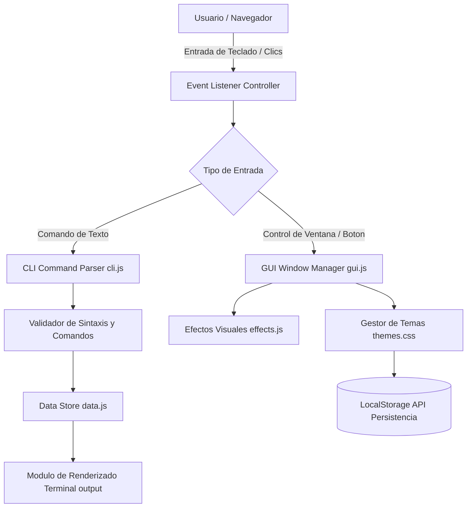

# SarmientoOS - Portafolio Interactivo y Consola CLI para Desarrollador de Software

Experiencia web interactiva que simula un entorno de consola UNIX y sistema de ventanas de escritorio para explorar proyectos, habilidades tecnicas y trayectoria profesional.

[]()
[]()
[]()
[]()

## Resumen Ejecutivo

Los portafolios estaticos convencionales a menudo carecen de interactividad y fallan al transmitir las capacidades tecnicas de un desarrollador de software. SarmientoOS reimagina la presentacion profesional ofreciendo un entorno inmersivo dual: una consola CLI con comandos tipo bash completamente funcionales para entusiastas de la terminal, combinada con una interfaz gráfica asistida por controles visuales, temas dinámicos e integración fluida.

## Alcance y Objetivos de Negocio

- Demostracion practica de competencias avanzadas en JavaScript vanilla, manipulacion del DOM y animaciones basadas en CSS moderno.
- Soporte dual de interaccion: terminal textual por comandos e interfaz grafica asistida por clics (GUI).
- Motor de temas visuales en tiempo real (Dracula, Nord, Monokai, Matrix, Cyberpunk).
- Simulador de ejecucion de comandos con autocompletado mediante tecla Tab y navegacion de historial con flechas Arriba/Abajo.
- Respaldo de configuracion y preferencias de sesion mediante LocalStorage.

## Arquitectura del Sistema

La aplicacion se estructura como una aplicacion web de una sola pagina (SPA) completamente modular sin dependencias pesadas de frameworks:
1. Capa de Presentacion (`index.html`, modulos CSS desacoplados).
2. Capa de Logica de Terminal y Parser de Comandos (`cli.js`, `autotyper.js`).
3. Capa de Gestion de Interfaz y Ventanas (`gui.js`, `effects.js`).
4. Capa de Datos Estructurados (`data.js`) y Controlador Principal (`app.js`).

### Diagrama de Flujo Arquitectonico



### Estructura de Directorios

```text
Portfolio/
├── index.html           # Documento principal y esqueleto de la ventana de terminal
├── README.md            # Documentacion tecnica del proyecto
├── css/                 # Hojas de estilo modulares
│   ├── dashboard.css    # Diseno de metricas y widgets de resumen
│   ├── style.css        # Reset, fuentes y distribucion global
│   ├── terminal.css     # Estilos de la consola, cursor parpadeante y prompts
│   ├── themes.css       # Definicion de variables y temas de color
│   └── window.css       # Controles de ventana (cerrar, minimizar, maximizar)
├── js/                  # Modulos JavaScript puros
│   ├── app.js           # Orquestador del ciclo de vida y arranque de la aplicacion
│   ├── autotyper.js     # Efecto mecanografico para texto inicial y bienvenida
│   ├── cli.js           # Parser de comandos de terminal e historial
│   ├── data.js          # Informacion estatica de proyectos, perfil y certificaciones
│   ├── effects.js       # Efectos de audio sintetizado, blur y transiciones
│   └── gui.js           # Manejo de botones, modal de ayuda e interactividad visual
└── img/                 # Recursos graficos, fotografias y diplomas
    ├── diploma.jpg      # Evidencias academicas verificables
    └── profile.png      # Avatar e imagen de presentacion del autor
```

## Stack Tecnologico

Desarrollado bajo una arquitectura ligera orientada a estandares web modernos, optimizando rendimiento y eliminando dependencias externas innecesarias.

### Motor de Ejecucion y Almacenamiento Web

-  Motor funcional de evaluacion de comandos, control de eventos y logica de navegacion.
-  Persistencia de preferencias de temas y configuracion entre sesiones de usuario.
-  Paradigma de emulacion de terminal de comandos UNIX/Linux.

### Interfaz, Tipografia y Diseno Visual

-  Semantica estructural garantizando accesibilidad y compatibilidad con lectores de pantalla.
-  Variables nativas CSS (Custom Properties), efectos de desenfoque y diseno responsivo.
-  Tipografias monoespaciadas para desarrolladores: Fira Code y JetBrains Mono.

### Integraciones y APIs del Navegador

- **Web Audio API**: Generacion de micro-sonidos sinteticos para simular el tipeo mecanico de teclado sin archivos de audio externos.
- **Clipboard API**: Capacidad de copiar comandos, correos electronicos y fragmentos de contacto con un solo clic.
- **Full-Screen API**: Soporte nativo para modo pantalla completa emulando una terminal de escritorio real.

## Requisitos Previos del Sistema

- Navegador web moderno con soporte de ES6 Modules y CSS Grid/Flexbox:
  - Google Chrome 90+
  - Mozilla Firefox 88+
  - Safari 14+
  - Microsoft Edge 90+
- Servidor web estatico local (Live Server, Python HTTP Server o Node.js `serve`).

### Parametros de Configuracion del Portafolio

El archivo `js/data.js` centraliza toda la informacion del portafolio:

```javascript
// Configuracion centralizada de perfil y proyectos
const USER_PROFILE = {
    name: "Santiago Sarmiento",
    title: "Software Engineer & Backend Specialist",
    github: "https://github.com/SantiSarmiento11",
    email: "sansamablogers@gmail.com",
    defaultTheme: "dracula"
};
```

## Guia de Instalacion y Despliegue Local

1. Clonar el repositorio:
```bash
git clone https://github.com/SantiSarmiento11/Portfolio.git
cd Portfolio
```

2. No se requieren pasos de compilacion o transpilacion externa gracias a la arquitectura nativa en JavaScript.

### Verificacion de Integridad de Archivos

Comprobar la presencia de la estructura de archivos principales mediante comando de terminal:
```bash
# En Linux / macOS:
ls -la js/ css/
# En Windows (PowerShell):
Get-ChildItem -Recurse -File
```

### Ejecucion en Servidor de Desarrollo Local

Opcion A: Utilizando el servidor integrado de Python 3:
```bash
python -m http.server 3000
```

Opcion B: Utilizando Node.js `npx serve`:
```bash
npx serve . -p 3000
```

Abra su navegador favorito en la URL: `http://localhost:3000`

## Funcionamiento del Sistema

El ciclo de vida del portafolio se divide en las siguientes etapas:
1. Carga inicial del DOM y verificacion de tema guardado en `localStorage.getItem('terminal_theme')`.
2. Inicializacion del autotyper con impresion secuencial de bienvenida y banner ASCII.
3. Activacion del cursor interactivo y preparacion del prompt de comandos `sarmiento@fullstack:~$`.
4. Escucha de teclado, gestion de buffers de texto y ejecucion de comandos parsedos.

### Flujo de Interaccion de Usuario

- **Modo Consola (CLI)**: El usuario escribe comandos directamente en el prompt y presiona `Enter` para recibir salidas formateadas.
- **Autocompletado con Tab**: Al presionar `Tab`, el sistema completa comandos conocidos o sugiere alternativas validas.
- **Historial con Flechas**: Presionar flecha `Arriba` o `Abajo` recupera comandos anteriores ejecutados en la sesion.
- **Modo Ventana (GUI)**: Clics en los botones superiores de la ventana permiten minimizar, maximizar o cambiar temas graficamente.

### Catalogo de Comandos Disponibles

| Comando | Parametros | Descripcion de la Accion |
| :--- | :--- | :--- |
| `help` | Ninguno | Muestra la lista completa de comandos reconocidos |
| `about` | Ninguno | Despliega biografia, formacion academica y enfoque tecnico |
| `projects` | `[id]` opcional | Lista todos los proyectos o profundiza en uno especifico |
| `skills` | `[categoria]` | Lista habilidades tecnicas divididas por backend, frontend y herramientas |
| `contact` | Ninguno | Proporciona enlaces a perfiles sociales, correo y redes |
| `theme` | `[nombre]` | Cambia el esquema de colores (`dracula`, `nord`, `matrix`, `monokai`) |
| `clear` | Ninguno | Limpia el historial de pantalla de la terminal |

### Especificacion de la Estructura de Datos (data.js)

Cada proyecto esta formalmente tipado en la coleccion de datos:
```json
{
  "id": "tech-nova",
  "title": "TechNova HelpDesk Platform",
  "description": "Sistema empresarial de gestion de tickets con Spring Boot y JPA",
  "technologies": ["Java", "Spring Boot", "MySQL", "JWT"],
  "link": "https://github.com/SantiSarmiento11/TechNova"
}
```

### Gestion de Errores y Comandos Invalidos

Cuando se ingresa un comando no reconocido:
- La consola emite un mensaje formateado: `Comando no reconocido: '<input>'. Escriba 'help' para ver los comandos disponibles.`
- El cursor de texto se limpia y vuelve a colocarse al inicio del nuevo prompt.
- No se interrumpe la ejecucion ni se bloquea el hilo principal de JavaScript.

## Estrategia de Pruebas y Aseguramiento de Calidad

- Validacion sintactica de codigo JavaScript utilizando ESLint.
- Verificacion de contraste y accesibilidad cromatica segun guias WCAG 2.1 AA en todos los temas.
- Comprobacion de adaptabilidad en dispositivos moviles, tabletas y monitores ultrapanoramicos.

### Comandos de Analisis Estatico y Calidad

```bash
# Ejecutar linter sobre los scripts de la aplicacion
npx eslint js/**/*.js

# Validar accesibilidad y mejores practicas con Lighthouse CLI
npx lighthouse-ci collect --url=http://localhost:3000
```

## Registro de Eventos y Metricas de Uso

La aplicacion mantiene un registro de eventos en la consola del navegador (`console.debug`) con fines de depuracion, rastreando comandos ingresados y cambios de estado de temas, sin recopilar datos personales sensibles del visitante.

## Consideraciones de Seguridad y Privacidad

- Sanitizacion de texto antes de la insercion en el DOM utilizando `textContent` en lugar de `innerHTML` no validado, mitigando riesgos de inyeccion de scripts entre sitios (XSS).
- Politica de Content Security Policy (CSP) compatible con recursos externos restringidos exclusivamente a Google Fonts.
